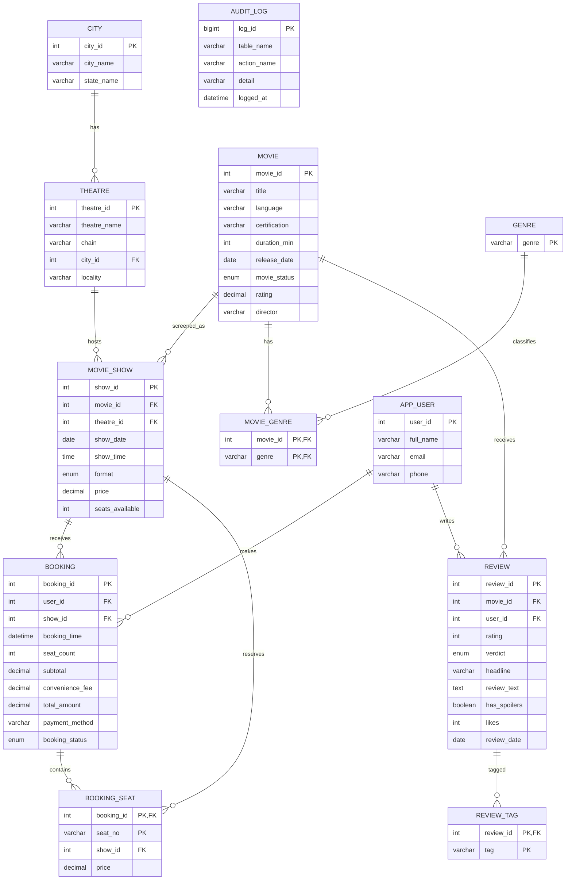

# NOIRBOX — Online Movie Ticket Booking System

**Database Management System (24CSE0209) — Project Report**
Semester III, Batch 2025, B.E. CSE

| | |
|---|---|
| **Title of the Project** | NOIRBOX — Online Movie Ticket Booking System |
| **Supervised By** | *(Faculty Name)* |
| **Submitted By** | *(Name, Roll Number — Group)* |
| **Department** | Computer Science and Engineering |
| **Institute** | Chitkara University Institute of Engineering and Technology, Chitkara University, Punjab |

---

## Table of Contents

1. Introduction
2. Problem Statement and Scope
3. E-R Diagram
4. Relational Schema and Data Dictionary
5. Normalization (1NF, 2NF, 3NF, BCNF)
6. Use Cases and SQL Implementation
7. Stored Programs (Procedures, Functions, Cursors, Triggers)
8. Transactions, Concurrency and Indexing
9. Security (DCL)
10. How to Run and Verify
11. Conclusion

---

## 1. Introduction

NOIRBOX is a cinema ticket booking application. A visitor selects a city, browses the
movies running there, opens a show, picks seats on a seat map, pays (demo payment) and
receives a ticket with a booking id. After watching the film the visitor can post a
review with a rating and tags, and the application shows an audience verdict for that
movie.

The SQL in this report was executed on MySQL 8.0.46 (five files, in the order shown
in section 10) before submission.

The application already has a working React frontend (`Project-1-main/`). This report
describes the **database layer** that stores exactly the same data: cities, theatres,
movies, genres, shows, users, bookings, booked seats, reviews and review tags.
The database is used by the Java application in `java-app/` and is also documented so
the same data model can be demonstrated directly in MySQL.

### Objectives

- Design a normalized relational database for a ticket booking system.
- Draw an E-R diagram and convert it into relations with primary and foreign keys.
- Implement the use cases of the application with SQL.
- Automate business rules with stored procedures, functions, cursors and triggers.
- Show transaction handling, concurrency control, indexing and access control.

---

## 2. Problem Statement and Scope

**Problem statement.** A cinema chain needs one database that records which movie is
playing in which theatre, on which date and time, at what price, and which seats each
customer has booked. The database must guarantee that the same seat of the same show is
never sold twice, must keep the seat count of every show correct automatically, and must
allow reports such as "revenue per theatre" and "average audience rating per movie".

**Users of the system**

| User | What they do |
|---|---|
| Visitor / Customer | Browse movies, view shows, book seats, cancel a booking, write a review |
| Box office / Admin | View all bookings, revenue reports, show-wise occupancy |
| Database administrator | Creates the schema, grants privileges, takes backups |

**Scope**

- In scope: cities, theatres, movies and genres, shows, seat booking and cancellation,
  reviews and tags, reporting queries.
- Out of scope: real payment gateway, OTT streaming, food ordering, seat layout editing.

---

## 3. E-R Diagram

### 3.1 Entities and attributes

| Entity | Key attributes | Other attributes |
|---|---|---|
| CITY | city_id (PK) | city_name, state_name |
| THEATRE | theatre_id (PK) | theatre_name, chain, locality, amenities |
| MOVIE | movie_id (PK), slug (unique) | title, language, certification, duration_min, release_date, movie_status, rating, popularity, director, tagline, description, poster_url, backdrop_url, trailer_url, featured |
| MOVIE_CAST | (movie_id, actor_name) PK | position (order of the actor in the credits) |
| GENRE | genre (PK, part of composite key of MOVIE_GENRE) | — |
| MOVIE_SHOW | show_id (PK) | show_date, show_time, format, price, seats_available |
| APP_USER | user_id (PK) | full_name, email (unique), phone |
| BOOKING | booking_id (PK) | booking_time, seat_count, subtotal, convenience_fee, total_amount, payment_method, booking_status |
| BOOKING_SEAT | (booking_id, seat_no) PK | price |
| REVIEW | review_id (PK) | rating, verdict, headline, review_text, has_spoilers, likes, review_date |
| TAG | tag (part of composite key of REVIEW_TAG) | — |
| AUDIT_LOG | log_id (PK) | table_name, action_name, detail, logged_at |

### 3.2 Relationships and cardinality

```
CITY (1) ──── has ──── (M) THEATRE
MOVIE (1) ──── has ──── (M) MOVIE_CAST
MOVIE (1) ──── has ──── (M) MOVIE_GENRE ──── belongs to ──── (1) GENRE
MOVIE (1) ──── screened as ──── (M) MOVIE_SHOW ──── held in ──── (1) THEATRE
APP_USER (1) ──── makes ──── (M) BOOKING ──── for ──── (1) MOVIE_SHOW
BOOKING (1) ──── contains ──── (M) BOOKING_SEAT ──── refers to ──── (1) MOVIE_SHOW
APP_USER (1) ──── writes ──── (M) REVIEW ──── about ──── (1) MOVIE
REVIEW (1) ──── tagged with ──── (M) REVIEW_TAG
```

- One city has many theatres, each theatre belongs to exactly one city. **(1 : M)**
- One movie has many shows; one show belongs to one movie and one theatre. **(1 : M)**
- One user makes many bookings; one booking has many seats. **(1 : M)** for bookings,
  and the seats inside a booking are a **multi-valued attribute** stored as
  `BOOKING_SEAT` (a weak entity, identified by booking + seat number).
- One movie has many reviews, one review has many tags. **(1 : M)**
- A movie has many genres and a genre belongs to many movies → **M : N**, resolved by
  the bridge table `MOVIE_GENRE`.
- `BOOKING_SEAT` has a **partial key** `seat_no`: the same seat number appears in many
  bookings of different shows, but only once per show (enforced by
  `UNIQUE(show_id, seat_no)`).

### 3.3 Mermaid source (paste into <https://mermaid.live> and export as PNG for the report)



---

## 4. Relational Schema and Data Dictionary

Full DDL: **`database/01_schema.sql`**. Key constraints:

| Table | Primary key | Foreign keys / unique constraints | Purpose |
|---|---|---|---|
| city | city_id | city_name UNIQUE | cities shown in the city selector |
| theatre | theatre_id | city_id → city | multiplex inside a city |
| movie | movie_id | — | one row per film |
| movie_cast | (movie_id, actor_name) | movie_id → movie | multi-valued cast (1NF) |
| movie_genre | (movie_id, genre) | movie_id → movie | multi-valued genres (1NF) |
| movie_show | show_id | movie_id → movie, theatre_id → theatre, UNIQUE(movie_id, theatre_id, show_date, show_time, format) | a screening |
| app_user | user_id | email UNIQUE | customer |
| booking | booking_id | user_id → app_user, show_id → movie_show | one purchase |
| booking_seat | (booking_id, seat_no) | booking_id → booking, show_id → movie_show, **UNIQUE(show_id, seat_no)** | seats of a booking; stops double booking |
| review | review_id | movie_id → movie, user_id → app_user, CHECK rating 1–10 | audience review |
| review_tag | (review_id, tag) | review_id → review | multi-valued tags (1NF) |
| audit_log | log_id | — | written by triggers |

**Derived (calculated) columns, explained in viva:**

- `booking.subtotal` = sum of `booking_seat.price` for that booking.
- `booking.convenience_fee` = `seat_count × 28`.
- `booking.total_amount` = subtotal + convenience fee.
- `movie_show.seats_available` is maintained **only** by triggers, never typed by hand.
- `review.verdict` is derived from `rating` by `trg_review_before_insert`.

**Views** (created in `01_schema.sql`):

| View | Purpose |
|---|---|
| `v_show_details` | show + movie + theatre + city in one row (show listing page) |
| `v_movie_rating` | review count, average rating and recommendation % per movie |
| `v_booking_summary` | one line per booking for "My Bookings" and reports |

---

## 5. Normalization

### 5.1 Un-normalized data collected from the UI

A first (student) attempt stored everything in one table:

```
BOOKING_SHEET(booking_id, user_name, user_email,
              movie_title, genres, director, duration,
              theatre_name, city, locality,
              show_date, show_time, format, base_price,
              seats, payment_method, total)
```

Problems: `genres` and `seats` hold several values in one column; user, movie and
theatre details repeat for every booking; a movie's director would have to be changed
in hundreds of rows.

### 5.2 First Normal Form (1NF) — atomic values

- Split `genres` into a separate relation `movie_genre(movie_id, genre)`.
- Split `seats` into `booking_seat(booking_id, seat_no, price)`.
- Split review tags into `review_tag(review_id, tag)`.
- Every column now holds a single atomic value, and every relation has a primary key.

### 5.3 Second Normal Form (2NF) — no partial dependency

In `booking_seat(booking_id, seat_no, price)`, the price depends on
`(booking_id, seat_no)` as a whole, so it is in 2NF.
In `movie_genre(movie_id, genre)` both attributes form the key, and there is no
non-key attribute, so no partial dependency exists.
All other relations have a single-attribute primary key, so 2NF is automatic.

### 5.4 Third Normal Form (3NF) — no transitive dependency

`theatre` originally stored `city_name` and `state_name`. Both depend on `city_id`,
not on `theatre_id`, which is a transitive dependency. They were moved to `city`, and
`theatre` keeps only `city_id` (foreign key).
Similarly `movie` no longer stores `theatre_name`, and `booking` no longer stores
`movie_title` or `user_email`.

### 5.5 BCNF

Every determinant in the final schema is a candidate key:

| Relation | Functional dependencies | Determinant is a key? |
|---|---|---|
| city | city_id → city_name, state_name | yes |
| theatre | theatre_id → theatre_name, chain, city_id, locality | yes |
| movie_show | show_id → movie_id, theatre_id, show_date, show_time, format, price, seats_available | yes |
| booking | booking_id → user_id, show_id, seat_count, total_amount, … | yes |
| booking_seat | (booking_id, seat_no) → price | yes |
| review | review_id → movie_id, user_id, rating, headline, … | yes |

Hence the schema is in BCNF.

---

## 6. Use Cases and SQL Implementation

Every use case below is implemented in **`database/05_use_cases.sql`**. Run that file
in MySQL Workbench to produce the output for the report screenshots.

| # | Use case (problem statement) | SQL concepts demonstrated |
|---|---|---|
| UC1 | Show the list of movies that are currently running | SELECT, WHERE, ORDER BY |
| UC2 | Show all screenings of one movie in a city on a date | 4-table INNER JOIN, filtering |
| UC3 | Show booked / free seats and the price of each seat | derived table, LEFT JOIN, stored function |
| UC4 | Book a ticket for selected seats | stored procedure, transaction, row lock, WHILE loop, exception handler |
| UC5 | Cancel a booking and release seats | UPDATE, DELETE, trigger |
| UC6 | Audience verdict: average rating and recommendation % | COUNT, AVG, CASE, GROUP BY, HAVING |
| UC7 | Revenue and tickets sold per theatre | multi-table join, SUM, GROUP BY, HAVING |
| UC8 | Movies rated above the overall average | nested sub-query |
| UC9 | Customers who booked or reviewed | UNION, IN (sub-query) |
| UC10 | Shows that have no booking yet | NOT EXISTS (correlated sub-query) |
| UC11 | Use the three views | views |
| UC12 | One booking with all its seats in one row | GROUP_CONCAT, aggregate join |
| UC13 | Manual transaction with rollback on duplicate seat | START TRANSACTION, ROLLBACK |
| UC14 | Cursor reports | CURSOR, OPEN/FETCH/CLOSE, handler |
| UC15 | Create a limited application user | CREATE USER, GRANT, REVOKE |
| UC16 | Prove that triggers keep availability and audit log correct | triggers, audit table |
| UC17 | Check that the show query uses an index | EXPLAIN |

### 6.1 Example — UC2 (show listing)

```sql
SELECT ms.show_id, m.title, t.theatre_name, c.city_name,
       ms.show_date, ms.show_time, ms.format, ms.price, ms.seats_available
FROM movie_show ms
JOIN movie   m ON m.movie_id   = ms.movie_id
JOIN theatre t ON t.theatre_id = ms.theatre_id
JOIN city    c ON c.city_id    = t.city_id
WHERE m.title = 'Spider-Man: Brand New Day'
  AND c.city_name = 'Mumbai'
  AND ms.show_date = CURDATE()
ORDER BY ms.show_time;
```

**Expected output:** one row per show — show id, movie, theatre, city, date, time,
format, price and the number of seats left.

### 6.2 Example — UC4 (booking with transaction)

```sql
CALL sp_book_ticket(3, 22, 'C1,C2', 'UPI', @new_booking, @new_total);
SELECT @new_booking AS booking_id, @new_total AS total_amount;
```

The procedure locks the show row with `SELECT ... FOR UPDATE`, inserts the booking,
inserts each seat, updates the totals and commits. Any SQL error (for example a seat
that is already booked) triggers the `EXIT HANDLER`, which rolls the whole booking back.

---

## 7. Stored Programs

File: **`database/04_procedures_functions.sql`** and **`database/02_triggers.sql`**.

### 7.1 Functions

| Function | Returns | Used for |
|---|---|---|
| `fn_seat_category(seat)` | Premium / Executive / Normal | seat map label |
| `fn_seat_price(show_id, seat)` | price of one seat (base × 1.55 / 1.20 / 1.00) | pricing in SQL and from Java |
| `fn_recommend_percent(movie_id)` | % of reviews with rating ≥ 7 | audience verdict card |
| `fn_loyalty_points(user_id)` | 1 point per ₹100 spent | customer report |

### 7.2 Procedures

| Procedure | Demonstrates |
|---|---|
| `sp_book_ticket(user, show, seats, method, OUT id, OUT total)` | transaction, `FOR UPDATE` lock, `WHILE` loop, `SIGNAL`, `EXIT HANDLER`, rollback |
| `sp_cancel_booking(booking_id, OUT message)` | transaction, `IF / ELSEIF`, status change, seat release |
| `sp_theatre_report(city)` | `CURSOR`, `LOOP`, `FETCH`, `CONTINUE HANDLER FOR NOT FOUND` |
| `sp_movie_show_report(movie_id)` | cursor over shows + correlated count sub-query |

### 7.3 Triggers

| Trigger | Event | Action |
|---|---|---|
| `trg_booking_seat_after_insert` | AFTER INSERT on booking_seat | `seats_available = seats_available - 1`, write audit row |
| `trg_booking_seat_after_delete` | AFTER DELETE on booking_seat | `seats_available = seats_available + 1`, write audit row |
| `trg_review_before_insert` | BEFORE INSERT on review | rejects rating outside 1–10 with `SIGNAL`, trims the headline, derives the verdict |

Because availability is changed only by triggers, the number of seats left can never
drift away from the actual booked seats. This is one of the strongest points to show in
the viva:

```sql
-- 1. create one more booking for show 1
INSERT INTO booking (user_id, show_id, seat_count, subtotal,
                     convenience_fee, total_amount, payment_method)
VALUES (2, 1, 1, 0, 0, 0, 'UPI');

-- 2. read the base price into a variable, then add the seat
--    (the trigger updates movie_show, so the INSERT must not read it)
SET @base = (SELECT price FROM movie_show WHERE show_id = 1);
INSERT INTO booking_seat (booking_id, show_id, seat_no, price)
VALUES (LAST_INSERT_ID(), 1, 'B5', ROUND(@base * 1.55));

-- 3. seats_available is one less and the trigger wrote an audit row
SELECT seats_available FROM movie_show WHERE show_id = 1;
SELECT * FROM audit_log ORDER BY log_id DESC LIMIT 1;
```

---

## 8. Transactions, Concurrency and Indexing

### 8.1 ACID in this project

| Property | How it is achieved |
|---|---|
| Atomicity | booking row + seat rows are inserted inside one transaction; any failure rolls all of them back |
| Consistency | `UNIQUE(show_id, seat_no)`, CHECK constraints, and triggers keep data valid |
| Isolation | `SELECT ... FOR UPDATE` locks the show row; InnoDB default isolation is REPEATABLE READ |
| Durability | InnoDB writes committed transactions to the redo log |

### 8.2 Concurrency problem and solution

Two users open the same show and both click seat `A1`.

1. Without protection both transactions read "seat A1 is free" and both insert a row.
2. With `SELECT ... FOR UPDATE` on the show row, the second transaction waits for the
   first one to commit.
3. The `UNIQUE(show_id, seat_no)` constraint then rejects the duplicate insert, and the
   second booking is rolled back with an error — the seat is sold only once.

### 8.3 Indexes

| Index | Column(s) | Speeds up |
|---|---|---|
| `idx_show_movie_date` | movie_show(movie_id, show_date) | "shows of this movie today" |
| `idx_show_theatre` | movie_show(theatre_id) | theatre reports |
| `idx_booking_user` | booking(user_id) | "My Bookings" |
| `idx_booking_show` | booking(show_id) | occupancy of a show |
| `idx_review_movie` | review(movie_id) | average rating per movie |
| `idx_movie_status` | movie(movie_status) | now showing / coming soon lists |
| unique keys | booking_seat(show_id, seat_no), app_user(email) | correctness, not only speed |

`EXPLAIN SELECT * FROM movie_show WHERE movie_id = 1 AND show_date = CURDATE();`
shows `key: idx_show_movie_date`.

---

## 9. Security (DCL)

The application connects with a limited MySQL account, not with `root`:

```sql
CREATE USER 'noirbox_app'@'localhost' IDENTIFIED BY 'Noirbox@123';
GRANT SELECT, INSERT, UPDATE, DELETE ON noirbox_db.* TO 'noirbox_app'@'localhost';
GRANT EXECUTE ON noirbox_db.* TO 'noirbox_app'@'localhost';
-- the application never needs to drop tables:
REVOKE DROP ON noirbox_db.* FROM 'noirbox_app'@'localhost';
SHOW GRANTS FOR 'noirbox_app'@'localhost';
```

The Java application uses `PreparedStatement` everywhere, so SQL injection through a
movie title or an email is not possible.

---

## 10. How to Run and Verify

```
mysql -u root -p < database/01_schema.sql
mysql -u root -p < database/02_triggers.sql
mysql -u root -p < database/03_sample_data.sql
mysql -u root -p < database/04_procedures_functions.sql
mysql -u root -p < database/05_use_cases.sql
```

Or open each file in MySQL Workbench and press the lightning button, in the same order.

Checklist for the demonstration (each line is one screenshot in the report):

1. `SHOW TABLES;` — 12 tables.
2. `DESC booking_seat;` — show the unique key and foreign keys.
3. UC2 query — show listing.
4. `CALL sp_book_ticket(...)` — booking with procedure.
5. `SELECT seats_available FROM movie_show WHERE show_id = ...;` before/after — trigger.
6. Second `CALL sp_book_ticket` with the same seats — error 1062, rollback.
7. `CALL sp_theatre_report('Mumbai');` — cursor output.
8. UC6 query — audience verdict.
9. `EXPLAIN` — index usage.
10. `SELECT * FROM audit_log;` — trigger evidence.

---

## 11. Conclusion

The project stores every piece of data that the NOIRBOX frontend shows in a normalized
MySQL database. The design removes redundancy (3NF/BCNF), protects correctness with
primary keys, foreign keys, unique constraints and triggers, and implements the main use
cases with joins, aggregates, sub-queries, stored procedures, functions and cursors.
The Java client in `java-app/` uses the same schema through JDBC, so the database and
the application can be demonstrated together in the viva.
